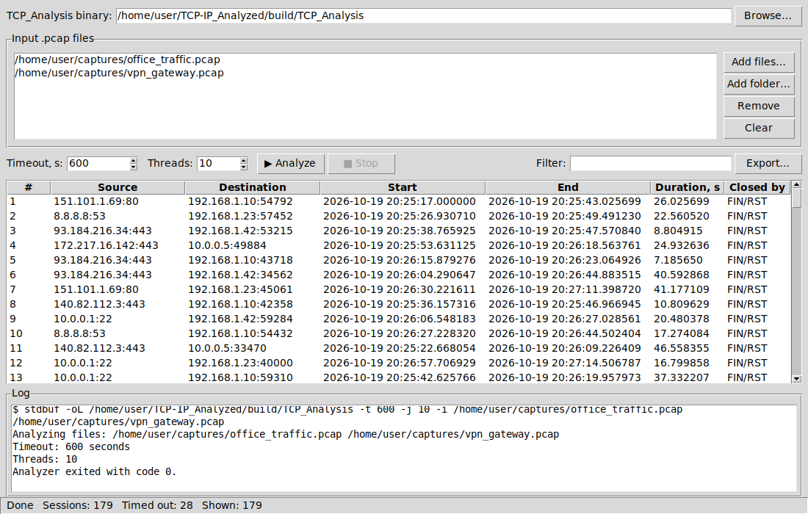
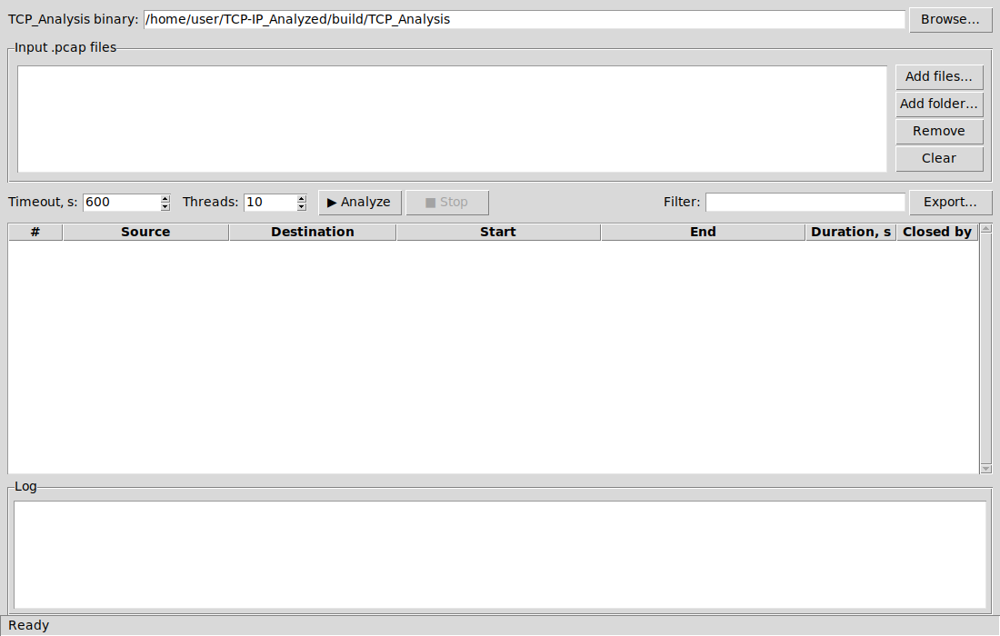
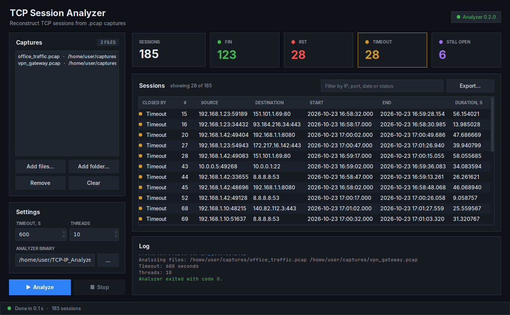
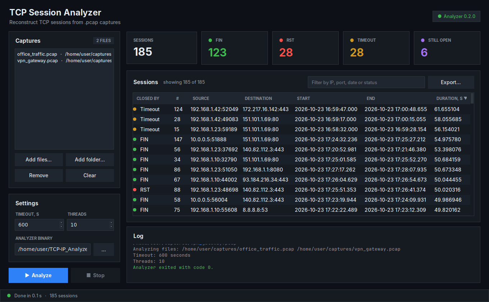

<p align="center">
  
</p>

<h1 align="center">SYNFIN</h1>

<p align="center"><b>TCP sessions from SYN to FIN</b></p>

<p align="center">
  <a href="https://github.com/konerai/SynFin/releases/latest"></a>
  
  
  <a href="https://github.com/konerai/SynFin/actions/workflows/ci.yml"></a>
</p>

SynFin is a multithreaded C++ tool that reads `.pcap` / `.pcapng` capture files, reconstructs TCP sessions from the raw packets, and reports each session — who opened it and to whom (IP and port), start/end timestamps, and how it ended: FIN, RST, idle timeout, or still open when the capture ended. It comes with two front ends:

- **`synfin`** — the command-line analyzer for Linux and Windows (`synfin.exe`, a single portable file); prints one JSON object per session to `stdout`, ready to pipe into `jq`, a log shipper or a script.
- **SynFin GUI** — a dark-themed desktop window for Linux (Python + Tkinter) that runs the analyzer for you and shows the sessions in a sortable, filterable table. A portable Windows GUI is in the works.



> SynFin was called *TCP-IP_Analyzed* before v0.3.0, and its binary was `TCP_Analysis`.

It's built for offline analysis of large packet captures: instead of loading a whole capture into memory, it reads packets as a stream, shards them across worker threads by session, and emits results as soon as each session ends.

## Contents

- [Where it runs](#where-it-runs)
- [Download](#download)
- [Requirements](#requirements)
- [Building](#building)
- [Graphical interface](#graphical-interface)
- [Command-line usage](#command-line-usage)
- [Output format](#output-format)
- [How it works](#how-it-works)
- [Project layout](#project-layout)
- [Tests](#tests)
- [Known limitations](#known-limitations)

## Where it runs

**Linux and Windows.** The analyzer is plain C++17 with no third-party libraries — it reads capture files itself — so it builds with any recent GCC, Clang or MSVC, and as a single portable `synfin.exe` for Windows 10/11 (see [Building](#building)). The GUI is Python + Tkinter and runs on any Linux desktop (X11 or Wayland via XWayland); a portable Windows GUI is in the works.

Tested builds (the analyzer builds without warnings with `-Wall -Wextra` and passes the [test suite](#tests)):

| Distribution | Compiler | CMake |
| --- | --- | --- |
| Ubuntu 24.04 LTS | GCC 13.3 | 3.28 |
| Ubuntu 22.04 LTS | GCC 11.4 | 3.22 |
| Debian 12 | GCC 12.2 | 3.25 |
| Fedora 42 | GCC 15 | 3.31 |

**Input:** offline capture files — what `tcpdump -w`, `dumpcap` and Wireshark save:

- **file formats:** `.pcap` (microsecond or nanosecond timestamps, either byte order) and `.pcapng` (any number of sections and interfaces);
- **link layers:** Ethernet (including 802.1Q / QinQ VLAN tags), Linux cooked capture v1 and v2 (`tcpdump -i any`), raw IP, and BSD/Npcap loopback.

Only IPv4/TCP packets are analyzed; everything else (IPv6, UDP, ARP, …) is skipped. Live capture from a network interface is not supported.

## Download

Ready-to-run builds are attached to every [release](https://github.com/konerai/SynFin/releases/latest).

### Linux (x86_64, ARM64)

The archive holds the `synfin` binary, the GUI and its icons. The binary needs only glibc 2.34+ (Ubuntu 22.04+, Debian 12+, Fedora 35+, RHEL 9+); releases up to 0.4.0 also needed `libdbus`.

```bash
tar -xzf synfin-<version>-linux-x86_64.tar.gz
cd synfin-<version>-linux-x86_64
./synfin --version
python3 gui/synfin_gui.py   # needs Tkinter, see below
```

### Windows (x64)

`synfin-<version>-windows-x64.exe` is a single portable file for 64-bit Windows 10 and 11 — nothing to install. Put it anywhere (rename it to `synfin.exe` if you like) and:

- **drop capture files onto it** in Explorer — a window opens with the sessions and stays open until you press Enter;
- **double-click it** to see the help;
- **run it from Command Prompt or PowerShell**, exactly like on Linux:

```bat
synfin.exe -i C:\captures\office.pcapng
synfin.exe -d C:\captures -t 300 > sessions.jsonl
```

The first time, Windows SmartScreen may say *"Windows protected your PC"* because the exe isn't code-signed: click **More info → Run anyway**. In Windows PowerShell 5.1, `>` writes UTF-16; use `| Set-Content -Encoding utf8 sessions.jsonl` to get a UTF-8 file for other tools.

To build from source instead, read on.

## Requirements

Analyzer — no libraries needed:

- CMake 3.10+
- A C++17 compiler (GCC 9+ or Clang 9+)

GUI (optional):

- Python 3.8+
- Tkinter (`python3-tk`); no other Python packages are needed

On Debian/Ubuntu:

```bash
sudo apt-get install build-essential cmake python3-tk
```

On Fedora:

```bash
sudo dnf install gcc-c++ cmake python3-tkinter
```

On Arch:

```bash
sudo pacman -S base-devel cmake tk
```

## Building

```bash
git clone https://github.com/konerai/SynFin.git
cd SynFin
mkdir build && cd build
cmake ..
make
```

This produces the `synfin` binary in `build/`.

### Windows command-line build

`synfin.exe` is cross-compiled from Linux with MinGW-w64 into a single static file that runs on 64-bit Windows 10/11 without installing anything:

```bash
sudo apt-get install g++-mingw-w64-x86-64-posix cmake
cmake -B build-win -DCMAKE_TOOLCHAIN_FILE=cmake/toolchain-mingw-w64-x86_64.cmake -DSYNFIN_STATIC=ON
cmake --build build-win
```

It also builds natively with Visual Studio 2022 (`cmake -B build -DSYNFIN_STATIC=ON && cmake --build build --config Release`). The exe carries the SynFin icon and version, and accepts file names in any language. A Windows GUI is in the works.

### Continuous integration

Every push and pull request is built and tested by [GitHub Actions](.github/workflows/ci.yml): on Linux with GCC, as a MinGW cross-built `synfin.exe` that is then tested on a real Windows machine, and natively with MSVC.

## Graphical interface

`gui/synfin_gui.py` is a dark-themed desktop front end for the analyzer. Build the analyzer first (see above), then from the project root:

```bash
python3 gui/synfin_gui.py
```

### Add SynFin to the application menu

To launch SynFin from your desktop's application menu or dock, with its icon:

```bash
gui/install-desktop-entry.sh
```

This installs a `synfin.desktop` entry and the icon for the current user only (under `~/.local/share`, no root needed). It points at the GUI where it is now, so run it again if you move the folder. Remove it with `gui/install-desktop-entry.sh --uninstall`.

The GUI looks for the binary at `build/synfin` (then `./synfin`, then `synfin` on `PATH`); another one can be chosen under **Settings → Analyzer binary**. The badge in the top-right corner shows the analyzer's version, or *Analyzer not found* in red.



### Workflow

1. **Captures** — **Add files…** picks one or more `.pcap` files, **Add folder…** adds every `.pcap` file in a directory. **Remove** (or the <kbd>Delete</kbd> key) deletes the selected entries, **Clear** empties the list.
2. **Settings** — **Timeout, s** is the idle time after which an unfinished session is reported as timed out (`--timeout`); **Threads** is the number of worker threads (`--threads`, defaults to the number of CPU cores).
3. **Analyze** — runs `synfin` on all listed files. A progress bar runs while it works and sessions appear in the table as they are reported; **Stop** terminates it early.
4. **Explore and export** the results (see below).

### Summary tiles

The row of tiles above the table counts the sessions by how they ended: **FIN** (both sides sent FIN), **RST** (reset), **Timeout** (idle longer than the timeout) and **Still open** (no FIN/RST, not idle long enough when the capture ended). Click a tile to show only those sessions, click it again (or **Sessions**) to show all.

### Results table

Each row is one TCP session reported by the analyzer:

| Column | Meaning |
| --- | --- |
| Closed by | How the session ended, with the tile's color: FIN, RST, Timeout or Still open |
| `#` | Order in which the analyzer reported the session |
| Source / Destination | `IP:port` of the endpoint that opened the connection, and of the one it connected to |
| Start / End | Timestamps of the first and last packet of the session, taken from the capture (local time; the table shows milliseconds, exports keep microseconds) |
| Duration, s | End − Start |

The status bar at the bottom shows whether the analyzer is running (with the elapsed time) or how long the last run took. Everything the analyzer writes besides session JSON (its header lines, errors on `stderr`, the exit code) goes to the **Log** pane.

### Filtering

Click a summary tile to filter by status, and/or type into the search box to show only rows where any column contains the text — an IP address, a port (`:443`), a date, or a status:



### Sorting

Click a column header to sort by it, click again to reverse the order; an arrow marks the sorted column. Numeric columns (`#`, Duration) sort by value — for example, the longest sessions first:



### Export

**Export…** saves all sessions from the last run (regardless of the filter):

- **CSV** (`.csv`) — the table's columns, with microsecond timestamps, ready for a spreadsheet;
- **JSON Lines** (`.jsonl`) — the analyzer's original JSON objects, one per line.

## Command-line usage

Analyze one or more capture files directly:

```bash
./synfin -i capture1.pcap capture2.pcapng
```

Or point it at a directory and it will pick up every `.pcap` and `.pcapng` file in it, in name order:

```bash
./synfin -d /path/to/captures/
```

### Options

| Option | Description | Default |
| --- | --- | --- |
| `-i`, `--input <files...>` | One or more capture files (`-i` itself is optional: arguments that aren't options are input files) | — |
| `-d`, `--dir <path>` | Directory to scan for `.pcap` / `.pcapng` files; can be given more than once | — |
| `-t`, `--timeout <seconds>` | Idle time (in capture time) after which an open session is force-closed and reported | `600` |
| `-j`, `--threads <n>` | Number of worker threads used to process sessions in parallel | number of CPU cores |
| `-q`, `--queue-size <n>` | Packets that may wait in the queue of each worker thread | `2048` |
| `-v`, `--version` | Show the version | — |
| `-h`, `--help` | Show usage information | — |

`--input`/`-i` and `--dir`/`-d` can be combined; at least one input file must be found or the tool exits with an error. Options with values also accept the `--option=value` form. A file that can't be read is reported on `stderr` and skipped; a file that is cut off is analyzed up to the point where it ends.

Before the sessions, the analyzer prints a few plain-text header lines (`Analyzing files: …`, `Timeout: …`, `Threads: …`) to `stdout`. Keep only the JSON lines when piping into other tools:

```bash
./synfin -i capture.pcap | grep '^{' | jq -r '"\(.source.ip):\(.source.port) -> \(.destination.ip):\(.destination.port)"'
```

## Output format

Each session is printed to `stdout` as a single-line JSON object:

```json
{"source":{"ip":"192.168.1.10","port":54321},"destination":{"ip":"93.184.216.34","port":443},"start_time":{"seconds":1717000000,"microseconds":123456},"end_time":{"seconds":1717000042,"microseconds":654321}, "timeout":false,"closed_by":"fin"}
```

- `source` — the endpoint that opened the connection: the sender of the session's first packet, or its receiver if that first packet is a SYN-ACK (the capture started mid-handshake). `destination` is the other endpoint.
- `start_time` / `end_time` — Unix timestamps of the first and last packet seen for the session, from the capture itself (not wall-clock time)
- `closed_by` — how the session ended:
  - `fin` — FIN seen from both sides;
  - `rst` — a RST was seen;
  - `timeout` — no packets for longer than `--timeout` seconds of capture time;
  - `end_of_capture` — the input ended while the session was still open and not yet idle for `--timeout`.
- `timeout` — `true` exactly when `closed_by` is `timeout` (kept for compatibility with 0.1.0)

## How it works

1. **Reading** – each input file is read packet by packet by SynFin's own reader (`capture_reader.h`), which understands `.pcap` and `.pcapng` without any external library.
2. **Parsing** – the link-layer header (Ethernet with optional VLAN tags, Linux cooked capture, raw IP or loopback) is skipped to reach the IPv4 header; only IPv4/TCP packets go further. The IPv4 and TCP headers are read byte by byte to get the source/destination IP and port and the TCP flags.
3. **Session sharding** – each packet is reduced to a canonical `SessionKey` (the IP:port pair of both endpoints, direction-independent) and hashed to one of *N* worker threads; packets travel to the workers in batches. Because a given session always hashes to the same worker, its packets are processed in order with no locking needed between sessions.
4. **Session tracking** – each worker keeps a hash map of open sessions and updates the start/end time on every packet. A session is closed and handed off for output when:
   - a **RST** is seen, or
   - **FIN** has been seen in both directions, or
   - it has been idle longer than `--timeout` seconds. Idle time is measured in capture time — against the timestamp of the packet being read, not the computer's clock — so old captures are handled correctly. The check runs every 1000 packets and once more at the end of the input.

   Sessions left open when the input ends are reported too, with `closed_by: "end_of_capture"`.
5. **Output** – a dedicated output thread drains completed sessions from a queue and prints one JSON object per line to `stdout`, so results can be consumed while analysis is still running.

The GUI is a thin wrapper: it starts `synfin -t <timeout> -j <threads> -i <files…>` as a subprocess (through `stdbuf -oL` when available, so rows arrive line by line), parses each JSON line from `stdout` into a table row and shows everything else in the log.

## Project layout

| Path | Contents |
| --- | --- |
| `synfin.cpp` | Command-line entry point: option parsing, input file discovery |
| `session_analyzer.h` | `SessionAnalyzer` — worker threads, session tracking, JSON output |
| `capture_reader.h` | Reader for `.pcap` and `.pcapng` files |
| `tcp_ip_headers.h` | Link-layer, IPv4 and TCP header parsing |
| `blocking_queue.h` | Thread-safe queue between the reader, the workers and the output thread |
| `CMakeLists.txt` | Build configuration (the version number lives here) |
| `cmake/toolchain-mingw-w64-x86_64.cmake` | Cross-compiling for Windows with MinGW-w64 |
| `windows/` | Windows icon and the resource file with the exe's version info |
| `.github/workflows/ci.yml` | Builds and tests on Linux and Windows |
| `gui/synfin_gui.py` | Tkinter GUI |
| `gui/icons/` | App icon in sizes from 16 to 512 px |
| `gui/install-desktop-entry.sh` | Adds SynFin to the application menu |
| `tests/test_sessions.py` | End-to-end test with a synthetic capture |
| `docs/screenshots/` | Screenshots used in this README |

## Tests

`tests/test_sessions.py` writes a synthetic capture with known sessions (normal close with the final ACK, reset with trailing packets, port reuse, capture starting mid-handshake, a real timeout, a session still open at the end, and 300 background sessions, all dated years in the past) and checks every session the analyzer reports. The same sessions are written in every supported file format (pcap with micro- and nanosecond timestamps, big-endian pcap, pcapng, big-endian nanosecond pcapng, pcapng with two sections) and link layer (Ethernet, VLAN, Linux cooked v1/v2, raw IP, loopback), with 1 and 4 worker threads:

```bash
python3 tests/test_sessions.py build/synfin
```

## Known limitations

- Only IPv4/TCP is analyzed; IPv6 traffic is skipped.
- Link layers other than the ones listed under [Where it runs](#where-it-runs) (for example raw 802.11 Wi-Fi frames from monitor mode) are skipped with a warning.
